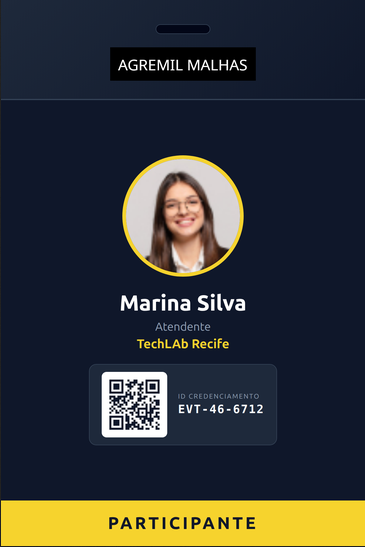
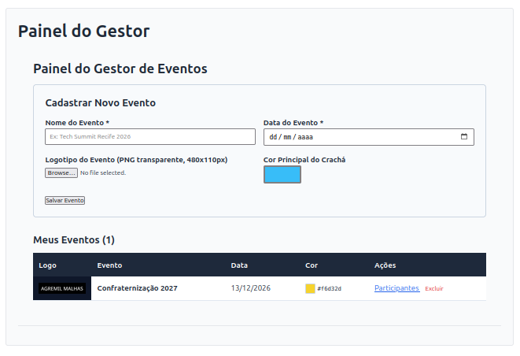
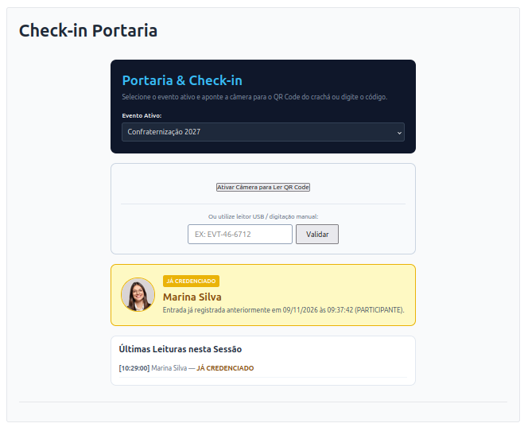

# Event Badge System (WordPress + Microserviço Docker)

Sistema completo e desacoplado para gestão multi-organização de eventos, credenciamento de participantes, geração de crachás em alta definição (`1200x1800px`) com QR Code dinâmico e validação de check-in na portaria.

Exemplo de **Crachá** gerado com o **plugin do WordPress**



Exemplo: Imagem de tela do **Painel do Gestor** no **plugin do WordPress**



Exemplo: Imagem de **Tela de portaria** no **plugin do WordPress**




## Arquitetura do Projeto

O sistema é dividido em dois módulos independentes que se comunicam via rede interna Docker (`eventos-shared-net`) através de requisições HTTP REST (`POST` JSON com autenticação Bearer Token):

1. **Plugin WordPress (`wp-plugin/wp-event-badge-manager`):** Gerencia o autocadastro de gestores, isolamento de dados por organização (multi-tenancy), cadastro de eventos e participantes, upload de mídia, disparo individual/em lote para geração de crachás e tela de check-in com leitor de QR Code.
2. **Microserviço de Renderização (`badge-service`):** API REST em PHP 8.3 + extensão GD + Browserless (Chromium Headless) responsável por gerar o QR Code, montar o template HTML/CSS dinâmico e devolver o arquivo PNG pronto para impressão.

## Estrutura do Repositório

```text
event-badge-system/
├── README.md
├── .gitignore
├── docs/
│   ├── 01-PRD.md                  # Requisitos do produto e regras de negócio
│   ├── 02-ARQUITETURA.md          # Topologia de rede Docker e modelagem de dados
│   └── 03-ROADMAP.md              # Fases de implementação do projeto
├── badge-service/                 # Microserviço Docker de renderização
│   ├── docker-compose.yml
│   └── src/
│       ├── api/
│       │   └── gerar.php          # Endpoint REST que gera QR Code e aciona o Chromium
│       └── assets/
│           └── fonts/             # Fontes personalizadas (.ttf / .woff2)
└── wp-plugin/
    └── wp-event-badge-manager/    # Plugin WordPress
        ├── wp-event-badge-manager.php
        └── includes/
            ├── class-roles-cpts.php
            ├── class-admin-settings.php
            ├── class-badge-api-client.php
            ├── class-front-portal.php
            └── class-checkin-portal.php
```

## Como Instalar e Executar

### 1. Criar a Rede Compartilhada Docker
No host Linux, crie a rede externa que permitirá a comunicação direta entre o container WordPress e o microserviço de crachás:

```bash
docker network create eventos-shared-net
```

### 2. Subir o Microserviço de Crachás (`badge-service`)
1. Acesse a pasta `badge-service/`.
2. Edite a variável `API_SECRET_TOKEN` no arquivo `docker-compose.yml` definindo uma chave segura.
3. Inicie os containers:

```bash
cd badge-service
docker compose up -d
```

### 3. Conectar e Configurar o WordPress
1. No `docker-compose.yml` do seu ambiente WordPress existente, adicione a rede externa `eventos-shared-net` ao serviço do WordPress e reinicie o container.
2. Copie a pasta `wp-plugin/wp-event-badge-manager` para `wp-content/plugins/` do seu WordPress.
3. No painel `/wp-admin`, ative o plugin **Event Badge Manager**.
4. Acesse **Configurações > Gerador de Crachás**, informe a URL `http://cracha-php/api/gerar.php` e o mesmo token definido em `API_SECRET_TOKEN`.
5. Utilize o botão **Gerar Crachá de Teste Agora** para validar a comunicação entre os containers.

## Shortcodes Disponíveis no WordPress

Crie páginas no WordPress e insira os seguintes shortcodes conforme o fluxo desejado:

| Shortcode | Finalidade |
| :--- | :--- |
| `[ebm_cadastro_gestor]` | Formulário público de autocadastro para novos gestores de eventos (`role: event_manager`). |
| `[ebm_painel_gestor]` | Painel front-end para o gestor criar eventos, cadastrar participantes, gerar crachás individuais ou em lote e baixar os PNGs. |
| `[ebm_checkin_portaria]` | Tela de credenciamento na portaria com leitura de QR Code via câmera (HTTPS) ou leitor USB/digitação manual, com bloqueio de entrada duplicada. |

## Segurança e Boas Práticas

* **Isolamento Multi-Tenant:** Todas as consultas e ações no front-end validam o `post_author`, impedindo que um gestor visualize, edite ou faça check-in de eventos pertencentes a outra organização.
* **Isolamento do Chromium:** O container `chrome-renderer` não possui portas expostas para o host nem para redes externas, respondendo exclusivamente ao container `cracha-php`.
* **Token Bearer:** Todas as requisições à API exigem o cabeçalho `Authorization: Bearer <TOKEN>`.

## Licença

Este projeto é distribuído sob a licença GPLv2. Sinta-se livre para usar, modificar e adaptar conforme as necessidades dos seus eventos.
